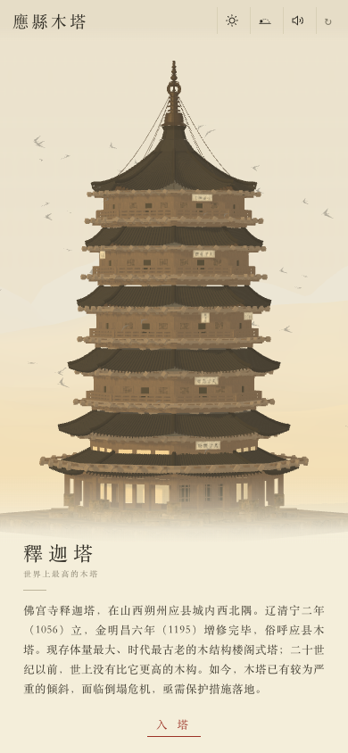
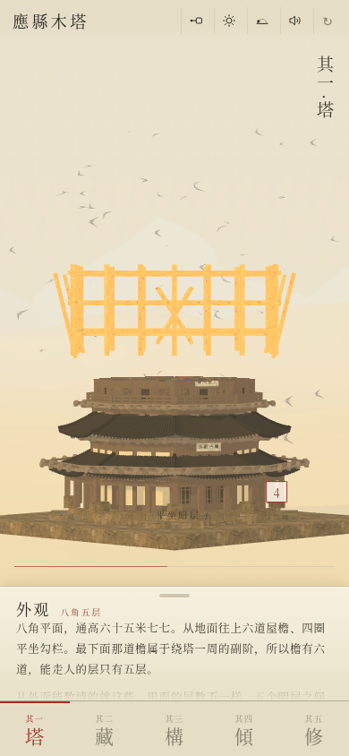
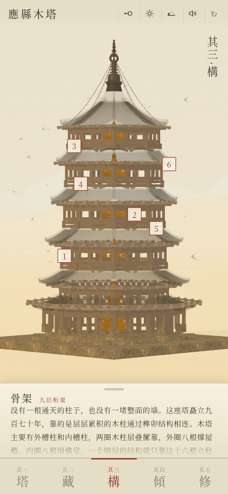
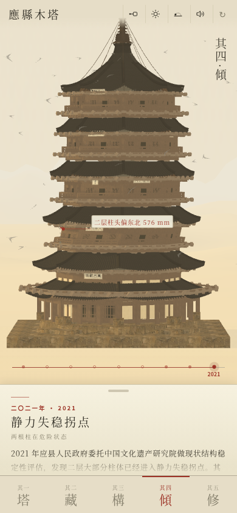
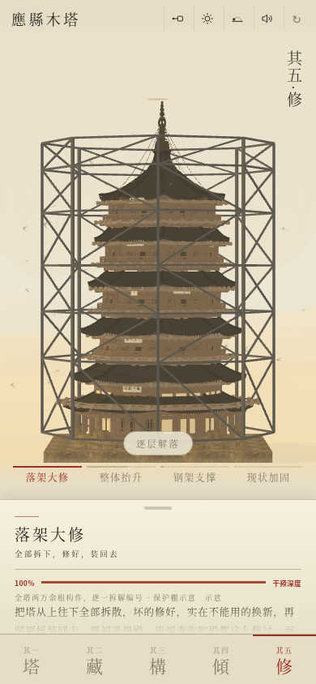
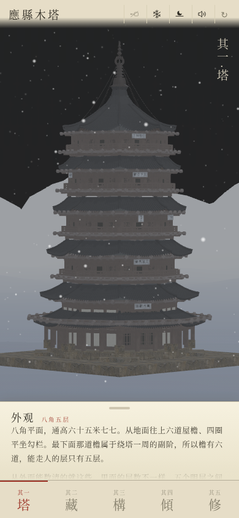

# Yingxian Pagoda · 應縣木塔

[中文](README.md) | English


The Sakyamuni Pagoda of Fogong Temple stands in the northwest corner of Ying County, Shuozhou, Shanxi. It was raised in 1056, the second year of the Qingning era of the Liao dynasty, and completed with additions in 1195, the sixth year of the Mingchang era of the Jin. It is the largest and oldest surviving multi-storey timber pagoda in China, and before the twentieth century nothing taller had been built in wood anywhere. It now leans badly enough that collapse is a real prospect, and no conservation plan has been carried out.

This project is an attempt to record the pagoda's fabric, its contents, its frame, the history of its lean, and the thirty-year argument over how to repair it.

[**See it running →**](https://larashero3-dotcom.github.io/yingxian-pagoda/)



## Five chapters

| | | |
|---|---|---|
| I · Fabric | Exterior | The pagoda assembles in 4.4 seconds; fifteen annotations are anchored to real coordinates and turn with it |
| II · Contents | What it holds | Sculpture and murals on five altars; scriptures found inside the fourth-storey figure |
| III · Frame | Nine-storey truss | Inner and outer column rings, four braced mezzanines, diagonal struts and tie beams |
| IV · Lean | Deformation | Nine dated marks, with column-head displacement in millimetres per storey |
| V · Repair | Proposals | Four approaches, their depth of intervention, the case for and against each, and the official position |

The last chapter reaches no conclusion. The argument over how to repair this pagoda has run for thirty years and is not settled.



## How it is built

### Where the dimensions come from

The geometry is driven by a survey table in millimetres, taken from Chen Mingda's measurements as tabulated in *Buildings* 2024, 14, 1472, Tables 1 and 2. The vertical segments in that table sum to 65,770 mm, which matches the total height the paper states, so the table closes on itself. Plan radii are recorded as the circumradius of the outer column ring, that is, half the across-corners plan dimension.

Scene scale is `14 / 65.77`, about 0.208 scene units per metre. The whole table is written in metres and scaled in one place, rather than converted piecemeal inside the geometry code.

Two figures for the total height are in circulation: 67.31 m and 65.77 m. The first is Liang Sicheng's storey-by-storey sum from the 1930s; 65.77 and 65.86 come from later instrument surveys. Both are real records, and the pagoda continued to settle and lean between them. This project uses the 65.77 table because it is internally consistent.

### Generating the geometry

The pagoda is generated from a set of geometry builders rather than loaded from a mesh file: swept plans, prisms of any number of sides, rings, arcs, and lathes. The octagonal plan, the inner and outer column rings, the braced mezzanine above each of the five open storeys, the verandah wrapping the ground floor, and the finial rising from 56.25 m are all parameter sets over the same builders.

Every roof tile is placed by a function of its position along the eave. The difference between a Liao eave and a Ming or Qing one comes down to three numbers: less lift at the corner, a much longer reach outward, and a nearly straight slope. Those three numbers are named once and shared by all six eaves.

Railing height is written as 1.10 m, the real height of a Liao balcony rail, and then scaled. An early version wrote 0.46 directly in scene units, which works out to 2.16 m: the railing came out taller than the storey it fronted and read as a lattice wall across the windows behind it. Anything that is a length is now recorded in metres. That was the lesson.

### The cut plane

The entire pagoda exists from the first frame. A downward-facing `THREE.Plane` travels up through the scene, every structural material clips against it, and nothing above the line is drawn. A cap mesh at the plane's height fills in a solid section, which is what turns a hollow clipped surface into what reads as a finished course. The scaffolding is excluded from this clipping, so it always stands one step above the finished work.

An octagonal tower needs different section shapes at different heights, so each segment declares the plan of its own section (four sides through the platform, eight through the shaft), and the cap geometry is rebuilt as the plane passes from one into the next. A single section shape would leave the plane cutting open wedges as it crossed the octagonal parts.

A finished frame is about 444,000 triangles in 34 draw calls.

### Annotations and coordinates

The fifteen component annotations are anchored to actual geometry coordinates and rotate and scale with the pagoda. A 390 px viewport has no room for leader lines, so each annotation takes the form of a tappable number sitting on the component itself, with the label expanding on tap.



### How the lean data is graded

Each of the nine marks in Chapter IV declares what kind of data it rests on: measured, recorded, back-calculated, or indicative. The stretch from 1056 to 1305 has no survey data at all, only the note that the pagoda was "repaired in every era," and is marked indicative. Itō Chūta's 1902 survey, the 1926 shelling by warlord troops, the removal of the wattle-and-daub infill walls in 1935, and Mo Zongjiang's 1950 re-examination rest on written records. The 1981 emergency stabilization is back-calculated from later measurements. The first full survey in 2004 and the static instability threshold reached by 2021 are measured.

Column-head displacement per storey comes from the China Academy of Cultural Heritage's measurements of August 2020: 576 mm on the second storey. That is the last complete survey to have been published. The final mark is set at 2021, the year of the assessment report itself. An earlier version extrapolated forward to 2026 at two to three millimetres a year; that was an extrapolation and has been withdrawn.



### How the repair proposals are attributed

Chapter V lays out four approaches with their depth of intervention: full disassembly and reassembly (100%), lifting the upper storeys (60%), an internal steel frame (5%), and in-situ stabilization (2%). Each carries the case for it, the case against it, and who holds which position.

The reasoning for shelving full disassembly is the official position, from the State Administration of Cultural Heritage and the China Academy of Cultural Heritage project group, 20 October 2020. The background is a review meeting in Taiyuan in June 2002 where more than forty specialists voted, and full disassembly was not the option that drew the most support; policy since then has been monitoring and research first, with emergency stabilization of the current fabric. The case against is quoted from Ding Yao.

Full disassembly was raised again in 2026, in a proposal from Shanxi delegates to the National People's Congress. That is a long-term recommendation and not the same thing as a construction plan approved by any level of the cultural heritage administration. On 18 March 2026 a claim that the pagoda was about to be dismantled spread on social media; the Shanxi Provincial Bureau of Cultural Heritage denied it the following day. The page marks this distinction explicitly.

The chapter gives no verdict. The argument has run thirty years without resolution, and a verdict here would leave the reader with an author more confident than the national heritage administration.



## What the portrait format decided

Chapter V locks the camera. In portrait only one proposal fits on screen at a time, so comparison depends on memory rather than side-by-side images. With the camera locked the pagoda does not move at all, and only the part a given proposal changes varies between them. A difference in the same position is easier to catch than one you have to hold in your head.

Chapter IV has no year buttons; it scrolls horizontally. Nine hundred and seventy years of leaning is a continuous process, and discrete buttons would read it as nine separate moments.

## Running it

The scripts are separate files, so a static server is required — `file://` will not load them:

```bash
python3 -m http.server 4173 --bind 127.0.0.1
```

Then open http://127.0.0.1:4173/. It is designed for portrait; switching the browser to a phone viewport (390×844) is closest to the real thing.

`preview.html` is a desktop version wrapped in a phone frame, generated from `index.html`:

```bash
python3 build/build-preview.py
```

## Layout

```text
yingxian-pagoda/
├── index.html          # the page: layout, text, five chapters
├── assets/
│   ├── app.js          # geometry, materials, cut plane, landscape, weather, interaction
│   ├── three.js        # Three.js r149, MIT
│   ├── tex.js          # 14 textures, WebP data URIs
│   └── audio.js        # audio, data URIs
├── preview.html        # desktop preview build (derived)
├── preview/            # README screenshots and hero images, not read at runtime
├── build/              # preview.html generator, plus the hero images' HTML source
├── LICENSE
└── THIRD-PARTY-NOTICES.md
```

The runtime payload is about 4.0 MB, most of which is not code: 2.46 MB of audio, 594 KB of Three.js, 518 KB of textures, and 361 KB of `app.js`. There is no build step, nothing to install, and no network request at runtime.

## Controls

Five chapter keys along the bottom. Four icons in the top bar, in order: annotations, weather (clear, rain, storm, snow), time of day (morning, noon, sunset, night), and sound. `↻` at the right replays the construction.

Drag to turn the pagoda, pinch to zoom, double-tap to recentre. Chapter IV scrolls horizontally to change the year; Chapter V to change the proposal.



## Provenance

The procedural geometry, the cut-plane construction animation, and the material, landscape and weather systems are adapted from the Country Towers component in [ThreeUI](https://github.com/MengTo/threeui) (MIT, © 2026 Meng To). The accompanying method is documented in [MengTo/Skills](https://github.com/MengTo/Skills) as `threejs-towers`, `threejs-landscape` and `threejs-weather`.

The Liao timber structure, the mezzanines and diagonal bracing, the nine-storey truss, the text of all five chapters, the compilation of the lean chronology and repair proposals, the audio processing, and the portrait interaction design are this project's own.

Third-party material is listed in [THIRD-PARTY-NOTICES.md](THIRD-PARTY-NOTICES.md).

## On accuracy

The pagoda is generated from published survey data. It is a research reconstruction, not a measured drawing. The geometry follows Chen Mingda's survey table, and the four repair proposals in Chapter V take their form from published drawings.

This project is not affiliated with any cultural heritage institution. The repair chapter presents the proposals without taking a position on any of them.

## Licence

MIT. See [LICENSE](LICENSE).
