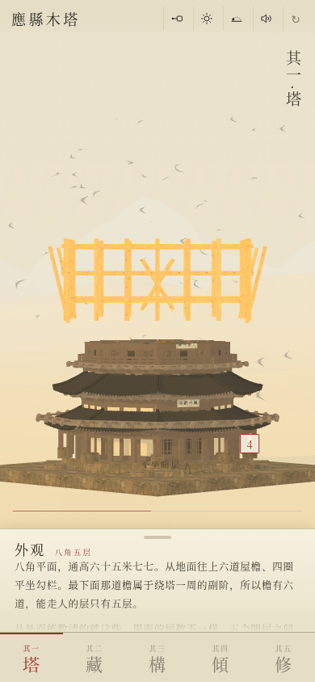
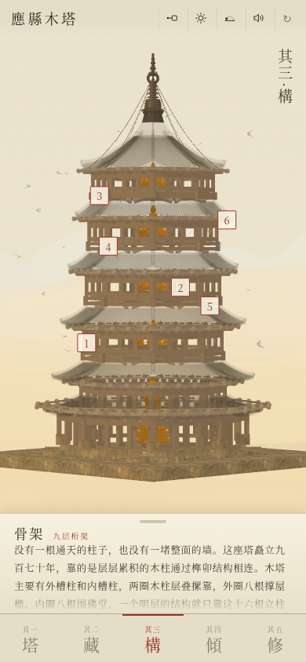
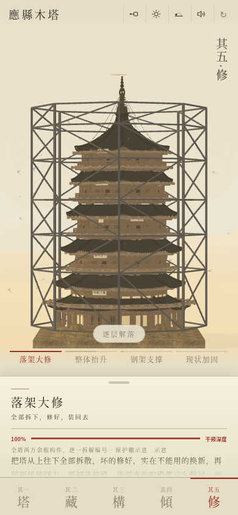
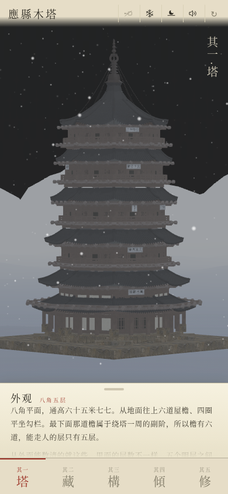

# 應縣木塔 · Yingxian Pagoda

中文 | [English](README.en.md)

[](https://moxt.ai)

佛宫寺释迦塔，在山西朔州应县城内西北隅。辽清宁二年（1056）立，金明昌六年（1195）增修完毕，俗呼应县木塔。现存体量最大、时代最古老的木结构楼阁式塔；二十世纪以前，世上没有比它更高的木构。如今，木塔已有较为严重的倾斜，面临倒塌危机，亟需保护措施落地。

这个项目希望记录木塔的外观、结构、内藏、倾斜历史及修缮方案之争。

**[直接体验 →](https://larashero3-dotcom.github.io/yingxian-pagoda/)**


## 五章

| | | |
| - | - | - |
| 其一 · 塔 | 外观 | 四点四秒长完一座塔，十五枚构件标注锚在真实坐标上，随塔转动 |
| 其二 · 藏 | 塔内珍藏 | 五座佛坛的塑像与壁画，四层主像腹中藏经 |
| 其三 · 構 | 九层桁架 | 内外两槽、四道暗层、斜戗与井栿 |
| 其四 · 傾 | 倾斜 | 九个纪年刻度，逐层柱头偏移毫米数 |
| 其五 · 修 | 修缮方案 | 四种修法的干预深度、支持与反对、官方口径 |

<br />



## 做法

### 尺寸来源

塔身几何由一张毫米制实测表驱动，数据取自陈明达实测、经 *Buildings* 2024, 14, 1472 表 1、表 2 整理的版本。表中所有竖向分段相加为 65,770 mm，与该文给出的总高一致，表本身自闭合。平面半径记作外槽柱圈的外接圆半径，即对角平面尺寸的一半。

场景尺度为 `14 / 65.77`，约 0.208 场景单位每米。全表以米记录，缩放在同一处完成，不在几何代码里散落换算。

通高有 67.31 与 65.77 两个数在流通。67.31 出自梁思成 1930 年代逐层实测的加总，65.77 与 65.86 出自后来的仪器测量，两者都是真实记录，塔在这段时间里继续沉降与倾斜。本项目采用 65.77 的实测表，理由是它内部一致。

### 几何生成

全塔由一组几何构件生成，不载入模型文件：扫掠平面、任意边数棱柱、环、弧、旋成面。八角平面、内外两圈柱、五个明层各压一道满布斜撑的暗层、底层副阶周匝、塔刹自 56.25 m 起至顶，都是同一套构件的参数组合。

屋面每一片瓦按它在檐上的位置由函数放置。辽代出檐与明清出檐的差别集中在三个数上：起翘小、外挑远、坡面近直，因此这三个数只命名一次，六道檐共用。栏杆高度按辽代平坐的实际尺度写成 1.10 m 再缩放；早期版本在这里直接写场景单位 0.46，折算为 2.16 m，栏杆高过它所临的那一层，在窗前形成一道格栅墙。凡属长度的量一律以米记录，是这次的教训。

### 剖切建造

整座塔从第一帧即已存在。一个朝下的 `THREE.Plane` 沿竖向穿过场景，所有结构材质对它做 clip，平面以上不绘制，剖切盘在平面高度处补出实心截面。脚手架不参与这一裁剪，因此始终立在完成面之上一步。

八角塔身在不同高度需要不同的截面形状，所以每一段自行申报它那一段的平面边数（台基为四，塔身为八），剖切盘随平面上升重建。若统一用一种截面，平面经过八角段时会留下敞口。

一个完成帧约 44 万三角、34 个 draw call。

### 标注与坐标

十五枚构件标注锚在实际几何坐标上，随塔一同旋转与缩放。竖屏 390 px 宽度内不具备布置引线的余量，因此标注取落在构件本体上的可点编号形式，标签在点击后展开。



### 倾斜纪年的数据分级

其四的九个刻度各自标注数据性质，分为实测、记述、回推、示意四类。1056 与 1305 一段无实测数据，只有「历代屡修」的记载，标为示意；1902 伊东忠太勘测、1926 军阀炮击、1935 拆夹泥墙、1950 莫宗江复查依据文献记述；1981 抢险加固由后来的测量回推；2004 首次全面实测与 2021 静力失稳拐点为实测。

逐层柱头偏移取 2020 年 8 月中国文化遗产研究院的测量，二层 576 mm，这是目前公布过的最后一套完整实测。末端刻度定在 2021，即评估报告本身的年份；早期版本按每年二至三毫米推算到 2026，属于外推，已撤回。


### 修缮方案的口径

其五陈列四种修法，标注各自的干预深度：落架大修（100%）、整体抬升（60%）、钢架支撑（5%）、现状加固（2%）。每一种列出支持理由、反对理由与主张者。

搁置落架的表述采用官方口径，出自国家文物局与中国文化遗产研究院项目组 2020-10-20，背景是 2002 年 6 月太原评审会四十余位专家投票，落架并非得票最多的方案，此后方针为监测研究先行、现状抢险加固。反对方引丁垚的表述。2026 年重提落架来自全国人大山西团代表的两会建议，属长远建议，与任何一级文物部门的施工计划不是同一主体；2026 年 3 月 18 日社交平台流传「木塔即将落架大修」，19 日山西省文物局已辟谣。这一区分在页面上单独标出。

本章不给结论。修缮方案争议三十年未定，若下结论，读者会得到一个比国家文物局更有把握的作者。



## 竖屏取舍

其五锁定相机。竖屏一次只能显示一个方案，横向比较依赖记忆而非并置图像。锁定相机后塔的位置不变，仅被该方案改动的部分发生变化，同一位置上的差异比并排比对更易察觉。

其四不设年份按钮，采用横向滑动。九百七十年的倾斜是连续过程，离散按钮会把它读成九个瞬间。

## 使用方式

需要静态服务器，脚本为独立文件，`file://` 无法加载：

```bash
python3 -m http.server 4173 --bind 127.0.0.1
```

然后打开 <http://127.0.0.1:4173/。按竖屏设计，浏览器切到手机视图（390×844）最接近实际。>

`preview.html` 是桌面预览版，外层套一个手机框，由 `index.html` 派生：

```bash
python3 build/build-preview.py
```

## 项目文件

```text
yingxian-pagoda/
├── index.html          # 页面：布局、文本、五章
├── assets/
│   ├── app.js          # 几何、材质、剖切、地景、天气、交互
│   ├── three.js        # Three.js r149，MIT
│   ├── tex.js          # 14 张贴图，WebP data URI
│   ├── audio.js        # 音频，data URI
│   └── moxt-logo.png
├── preview.html        # 桌面预览稿（派生物）
├── preview/            # README 用截图与 hero 图，运行时不读取
├── build/              # preview.html 的生成脚本、hero 图的 HTML 源
├── LICENSE
└── THIRD-PARTY-NOTICES.md
```

运行时载荷约 4.0 MB，其中大部分不是代码：音频 2.46 MB，Three.js 594 KB，贴图 518 KB，`app.js` 361 KB。无构建步骤，无需安装依赖，运行时不发起网络请求。

## 操作

底部五枚章节键切章。顶栏四枚图记依次为标注开关、天气（晴/雨/暴雨/雪）、时辰（晨/午/暮/夜）、声音，右侧 `↻` 重放建造动画。

拖动转塔，双指缩放，双击回正。其四横划改年份，其五横划换方案。



## 出处

塔身的程序化几何、剖切面建造动画、材质与地景系统改自 [ThreeUI](https://github.com/MengTo/threeui) 的 Country Towers 组件（MIT，© 2026 Meng To）。配套方法论见 [MengTo/Skills](https://github.com/MengTo/Skills) 的 `threejs-towers`、`threejs-landscape`、`threejs-weather`。

应县木塔的辽代木构几何、暗层与斜戗、九层桁架、五章文本、倾斜纪年与修缮方案的数据整理、音频处理与竖屏交互为本项目原创。

第三方素材清单见 [THIRD-PARTY-NOTICES.md](THIRD-PARTY-NOTICES.md)。

## 关于准确性

塔按公开实测数据生成，属研究性重建，不是测绘图。几何依据陈明达实测表，其五四个方案的形态参考公开图样。

本项目不隶属于任何文物机构。修缮方案部分只作陈列，不代表任何一方立场。

## 许可

MIT。见 [LICENSE](LICENSE)。

---

在 [Moxt](https://moxt.ai) 制作。
